<div align="center">


<br>


**Capyro** es un reproductor de audio y video liviano para Linux, con un capibara de mascota.<br>
Abrís un archivo, apretás play y listo: *just press play*.

[Funciones](#funciones) ·
[Efectos de audio](#efectos-de-audio) ·
[Actualizaciones](#4-actualizar) ·
[Distribuciones](#distribuciones) ·
[Instalación](#instalación) ·
[Atajos](#cómo-se-usa) ·
[Configuración](#configuración) ·
[Problemas](#solución-de-problemas)

</div>

> [!TIP]
> **Novedades de la v0.2.8:** **playlists** (hasta 3) además de la cola de siempre, un
> **editor de atajos** adentro de la app (⚙ → Editar configuración) y un botón de
> **Novedades** al lado de ⓘ que te cuenta qué cambió. [Ver el historial completo →](CHANGELOG.md)

<br>


## Funciones

<table>
<tr>
<td width="50%" align="center">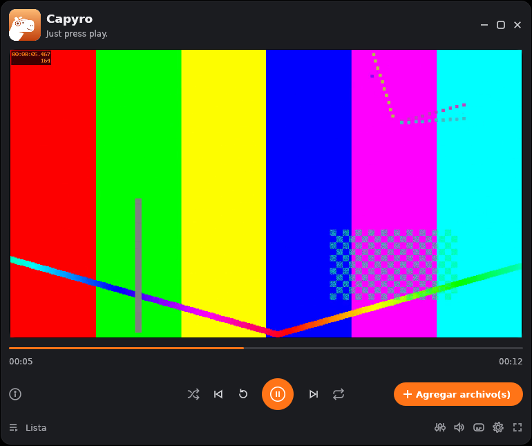<br><sub><b>Video</b> sincronizado con el audio</sub></td>
<td width="50%" align="center">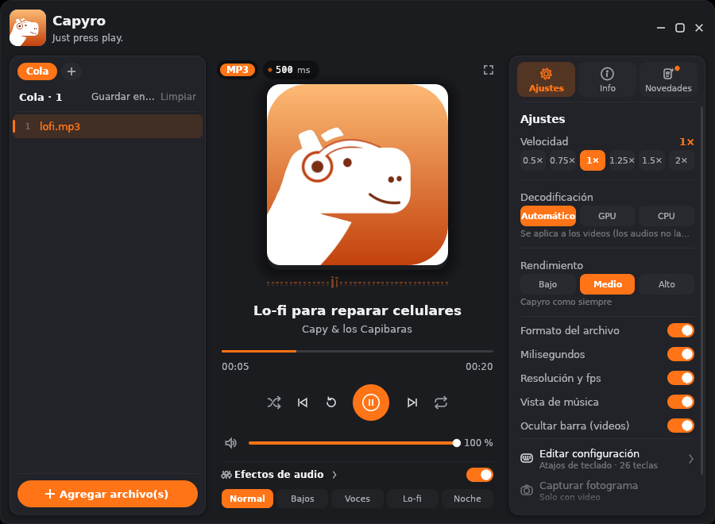<br><sub><b>Audio</b> con carátula, título y visualizador</sub></td>
</tr>
<tr>
<td align="center">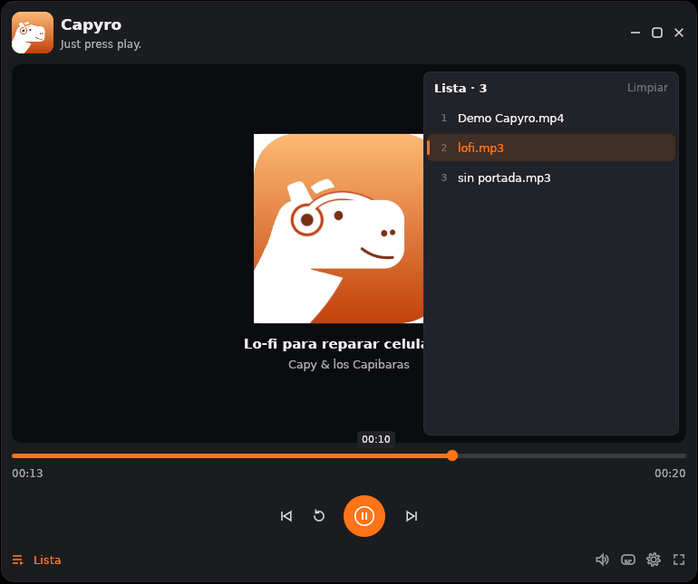<br><sub><b>Lista</b> con aleatorio, repetir y paso automático</sub></td>
<td align="center">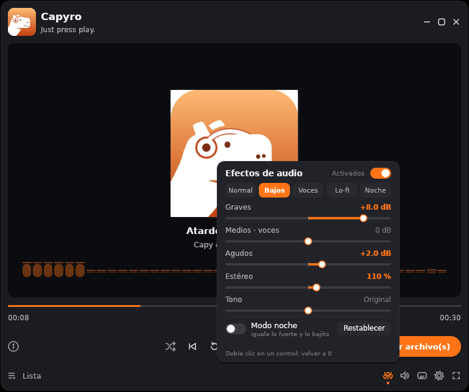<br><sub><b>Efectos de audio</b> que se escuchan al instante</sub></td>
</tr>
<tr>
<td align="center">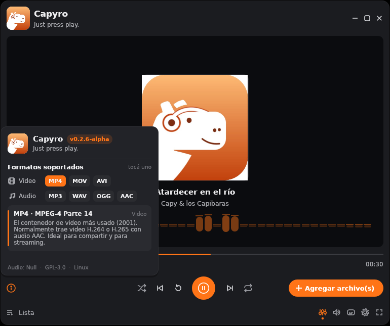<br><sub><b>ⓘ</b> versión, formatos y buscar actualizaciones</sub></td>
<td align="center">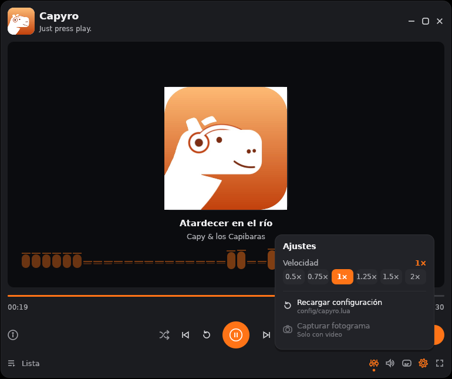<br><sub><b>⚙</b> velocidad, editar la configuración y capturas</sub></td>
</tr>
<tr>
<td align="center">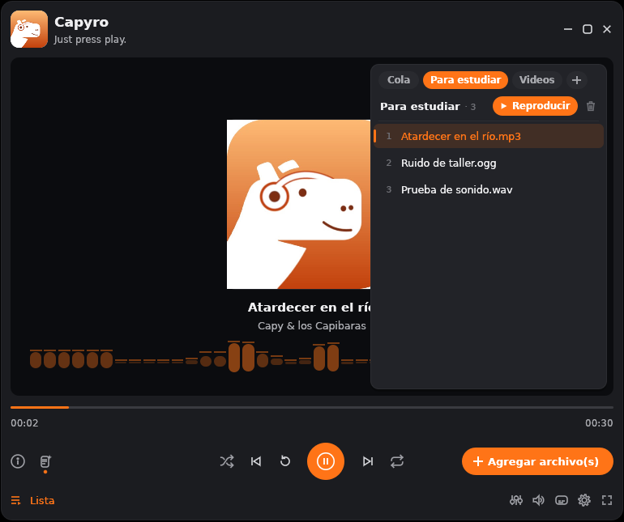<br><sub><b>Playlists</b>: hasta 3, además de la cola</sub></td>
<td align="center">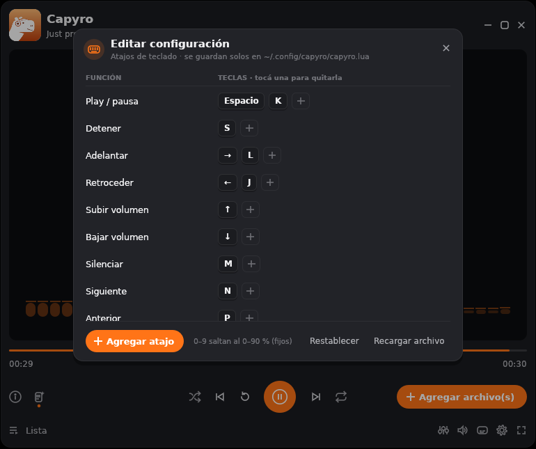<br><sub><b>Editar configuración</b>: los atajos, sin tocar archivos</sub></td>
</tr>
<tr>
<td align="center">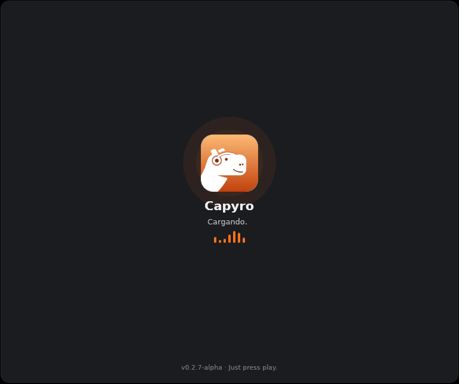<br><sub><b>Pantalla de carga</b> animada, con sonido de inicio</sub></td>
<td align="center">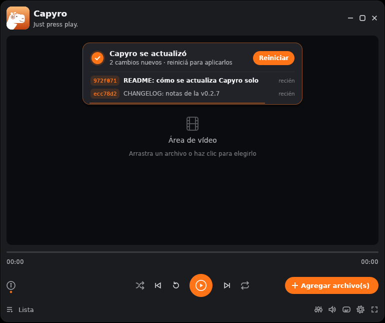<br><sub><b>Se actualiza solo</b> y te muestra el parche</sub></td>
</tr>
</table>

| | |
|---|---|
| ▶️ **Reproducción** | Audio y video con FFmpeg, video sincronizado con el audio, búsqueda precisa, velocidad de 0.5× a 2× **sin cambiar el tono**, saltos al 0–90 % con las teclas `0`–`9`. |
| 🎵 **Audio** | Carátula, título y artista, un visualizador de frecuencias propio y efectos de audio en tiempo real. |
| 📃 **Lista** | Una **cola** temporal y hasta **3 playlists** guardadas. Aleatorio sin repetidos, repetir la lista o un archivo, paso automático al siguiente y quitar archivos aunque estén sonando. |
| 💾 **Memoria** | Retoma la lista, el archivo, la posición, el volumen y los efectos de la última vez. |
| 📸 **Capturas** | Guarda el fotograma del video como PNG con `Shift`+`S`. |
| 🔄 **Actualizaciones** | Un botón busca commits nuevos en GitHub, compila e instala la versión nueva y te muestra qué cambió. |
| ✨ **Interfaz** | Ventana propia con esquinas redondeadas, pantalla de carga, botones animados, menús que aparecen deslizándose y avisos con fundido. |
| 🦫 **Detalles** | Tocá el logo y suena un capibara (hay tres, salen al azar). Al abrir suena el inicio, y al actualizarse, su propio sonido. |
| ⚙️ **Personalizable** | Los atajos se cambian **desde la app** (⚙ → Editar configuración) y todo queda en un archivo **Lua** que también podés editar a mano. |
| 📰 **Novedades** | Un botón al lado de ⓘ con lo nuevo de la versión que tenés. |


## Efectos de audio


Se abren con el botón **≡** a la izquierda del volumen, o con <kbd>Ctrl</kbd>+<kbd>E</kbd>.

| Control | Qué hace |
|---|---|
| **Graves** | ±12 dB alrededor de 120 Hz |
| **Medios · voces** | ±12 dB alrededor de 1,5 kHz, donde están las voces |
| **Agudos** | ±12 dB desde 6 kHz |
| **Tono** | ±12 semitonos **sin** cambiar la velocidad |
| **Estéreo** | De *Mono* (ideal con un solo auricular) a 200 % |
| **Modo noche** | Baja lo fuerte y sube lo bajito: se entienden los diálogos sin que las explosiones despierten a nadie |

**Presets:** Normal · Bajos · Voces · Lo-fi · Noche.<br>
El **interruptor general** (<kbd>Shift</kbd>+<kbd>E</kbd>) los apaga y prende para comparar.<br>
**Doble clic** en un control lo vuelve a 0, y la **rueda** lo mueve de a un paso.

El ecualizador está escrito en C y se aplica justo antes de que suene el audio, así que
cada cambio se escucha **al instante**. Un limitador suave evita que sature, aunque
pongas todo al máximo.

<br clear="right">


## Formatos

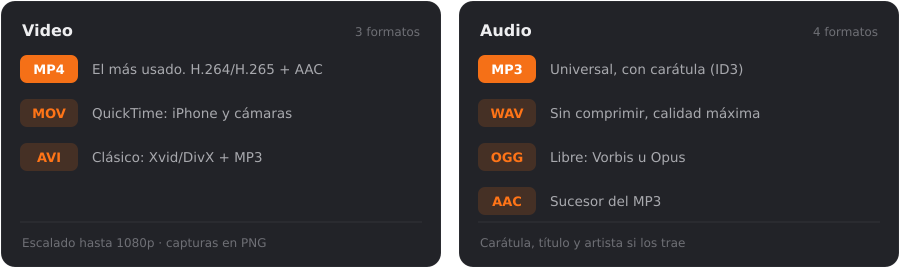

> [!NOTE]
> Si intentás abrir otro formato, Capyro te avisa con un sonido y un mensaje. Los formatos
> soportados también se ven dentro de la app, en el menú **ⓘ**: tocá uno para leer su resumen.


## Distribuciones

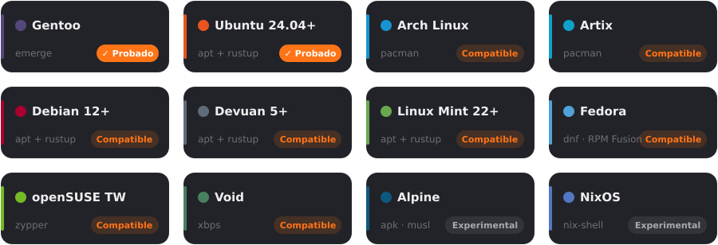

| Estado | Qué significa |
|---|---|
| **✓ Probado** | Compilado y usado de verdad en esa distro. |
| **Compatible** | Tiene todo lo necesario (FFmpeg 5.1+ y Rust 1.95+), pero todavía nadie lo probó. Si lo probás, ¡contanos! |
| **Experimental** | Debería andar con algún ajuste (musl en Alpine, rutas de librerías en NixOS). |

> [!WARNING]
> **No soportadas:** Ubuntu 22.04, Debian 11, Linux Mint 21 y anteriores. Traen FFmpeg 4.4
> y Capyro necesita **5.1 o más nuevo**.

Capyro es **solo para Linux** por ahora. Funciona en **X11 y Wayland** (Niri, Hyprland,
Sway, GNOME, KDE...), con **PipeWire, PulseAudio, ALSA o JACK**, y con **systemd o sin él**
(OpenRC, runit, s6...): no depende del sistema de inicio.


## Instalación

### 1. Dependencias

Necesitás CMake, un compilador de C, **Rust 1.95+**, las librerías de **FFmpeg 5.1+**, pkg-config y Git.
Elegí tu distro:

<details>
<summary><b>Gentoo</b> &nbsp;·&nbsp; probado</summary>

```sh
sudo emerge --ask dev-build/cmake dev-vcs/git dev-lang/rust media-video/ffmpeg dev-util/pkgconf
# selector de archivos (si no tenés uno):
sudo emerge --ask sys-apps/xdg-desktop-portal sys-apps/xdg-desktop-portal-gtk
# opcional, para compilar más rápido:
sudo emerge --ask dev-build/ninja dev-util/ccache
rustc --version   # si es menor a 1.95, usá rustup
```
</details>

<details>
<summary><b>Arch Linux · Artix</b> &nbsp;·&nbsp; compatible</summary>

```sh
sudo pacman -S --needed base-devel cmake git rustup ffmpeg pkgconf xdg-desktop-portal-gtk
rustup default stable
```
</details>

<details>
<summary><b>Debian 12+ · Devuan 5+ · Ubuntu 24.04+ · Linux Mint 22+</b> &nbsp;·&nbsp; probado en Ubuntu</summary>

El Rust de `apt` es demasiado viejo, así que usá rustup:

```sh
sudo apt install build-essential cmake git curl pkg-config ffmpeg \
    libavformat-dev libavcodec-dev libavutil-dev libavfilter-dev libswscale-dev
curl --proto '=https' --tlsv1.2 -sSf https://sh.rustup.rs | sh
source "$HOME/.cargo/env"
```
</details>

<details>
<summary><b>Fedora</b> &nbsp;·&nbsp; compatible</summary>

El FFmpeg de Fedora (`ffmpeg-free`) no trae H.264/H.265, que es lo que usan casi todos
los MP4. Usá el de RPM Fusion:

```sh
sudo dnf install https://mirrors.rpmfusion.org/free/fedora/rpmfusion-free-release-$(rpm -E %fedora).noarch.rpm \
                 https://mirrors.rpmfusion.org/nonfree/fedora/rpmfusion-nonfree-release-$(rpm -E %fedora).noarch.rpm
sudo dnf swap ffmpeg-free ffmpeg --allowerasing
sudo dnf install gcc cmake git pkgconf-pkg-config ffmpeg-devel
curl --proto '=https' --tlsv1.2 -sSf https://sh.rustup.rs | sh
```
</details>

<details>
<summary><b>openSUSE Tumbleweed</b> &nbsp;·&nbsp; compatible</summary>

```sh
sudo zypper install gcc cmake git pkgconf rustup \
    ffmpeg-7-libavformat-devel ffmpeg-7-libavcodec-devel ffmpeg-7-libavutil-devel \
    ffmpeg-7-libavfilter-devel ffmpeg-7-libswscale-devel
rustup default stable
```
Para H.264/H.265 (casi todos los MP4), instalá las versiones de FFmpeg del repositorio **Packman**.
</details>

<details>
<summary><b>Void Linux</b> &nbsp;·&nbsp; compatible</summary>

```sh
sudo xbps-install -S base-devel cmake git pkg-config ffmpeg-devel rust cargo
rustc --version   # si es menor a 1.95, usá rustup
```
</details>

<details>
<summary><b>Alpine</b> &nbsp;·&nbsp; experimental</summary>

```sh
doas apk add build-base cmake git pkgconf ffmpeg-dev rust cargo
```
Usa musl en vez de glibc y todavía no se probó. Con Alpine *edge* tenés un Rust lo
bastante nuevo.
</details>

<details>
<summary><b>NixOS</b> &nbsp;·&nbsp; experimental</summary>

```sh
nix-shell -p gcc cmake git pkg-config ffmpeg rustc cargo \
    libGL libxkbcommon wayland xorg.libX11 xorg.libXcursor xorg.libXi xorg.libXrandr
```
La ventana carga OpenGL, Wayland y xkbcommon en tiempo de ejecución: si no abre, exportá
`LD_LIBRARY_PATH` con esas librerías.
</details>

### 2. Compilar

```sh
git clone https://github.com/CapyIsInsano/Capyro.git
cd Capyro
cmake -B build -DCMAKE_BUILD_TYPE=Release
cmake --build build -j"$(nproc)"
./build/capyro
```

> [!TIP]
> Con [Ninja](https://ninja-build.org/) agregá `-G Ninja` al primer comando: reparte mejor los
> núcleos entre C y Rust. Si tenés `ccache`, se usa solo.

**¿Cuánto tarda?** La **primera** compilación arma ~160 dependencias de Rust: unos 4 minutos
con 2 núcleos, bastante menos con más. Después, **cualquier cambio recompila en ~3 segundos**.

<details>
<summary><b>Opciones de compilación</b></summary>

| Opción | Qué hace |
|---|---|
| *(ninguna)* | `-O3` en C y Rust, sin LTO: rápido de recompilar. Binario de ~10 MB. |
| `-DCAPYRO_DIST=ON` | LTO completo en C y Rust: binario ~15 % más chico (~8,4 MB). Para instalar o empaquetar. |
| `-DCAPYRO_NATIVE=ON` | Optimiza para **tu** procesador (`-march=native`). El binario no sirve en otras PCs. |
| `-DCAPYRO_CCACHE=OFF` | No usar `ccache`. |
| `-DCAPYRO_BUILD_TESTS=OFF` | No compilar las pruebas. |

La versión más optimizada posible para tu máquina:

```sh
cmake -B build-dist -G Ninja -DCMAKE_BUILD_TYPE=Release -DCAPYRO_DIST=ON -DCAPYRO_NATIVE=ON
cmake --build build-dist
```
</details>

### 3. Instalar

```sh
sudo cmake --install build                  # en /usr/local
cmake --install build --prefix ~/.local     # o solo para tu usuario
```

Instala el binario, la config de ejemplo, el lanzador `.desktop` (Capyro aparece en el menú
de aplicaciones y en "Abrir con…" para todos sus formatos) y el ícono.

> [!TIP]
> Si lo instalás **en tu usuario** (`--prefix ~/.local`), se actualiza sin pedir contraseña.
> Fijate que `~/.local/bin` esté en tu `PATH`.

### 4. Actualizar

Una vez instalado, Capyro se actualiza solo: **ⓘ → Buscar actualizaciones**.

1. Le pregunta al repo de GitHub cuál es el último commit (`git ls-remote`). Si es el mismo
   de tu Capyro, te dice que ya tenés la última.
2. Si hay algo nuevo, baja el código a `~/.cache/capyro/src` y te **muestra qué commits se van a
   instalar**: los que son más nuevos que el tuyo, con su hash, título y fecha. Recién cuando tocás
   **Instalar** sigue. Con **Ahora no** no se toca nada, y desde ⓘ lo volvés a ver con **Ver**.
3. Lo compila en `~/.cache/capyro/build` con las mismas opciones que usaste vos (prefijo,
   `CAPYRO_DIST`, `CAPYRO_NATIVE`), con prioridad baja para no trabar lo que estés mirando.
4. Lo instala en el mismo lugar donde está. Si es una carpeta del sistema (`/usr/local`), te
   pide la contraseña con `pkexec`.
5. Suena el aviso, aparece **el parche** (los commits nuevos) y te pide **reiniciar**: con un
   clic se vuelve a abrir en la versión nueva, con tu lista y tu posición.

La **primera** actualización compila todo (unos minutos, como la primera vez). Las
siguientes reutilizan lo compilado y tardan **segundos**. Mientras tanto podés seguir usándolo.

| Para que funcione | |
|---|---|
| Capyro **instalado** | Corriendo desde `build/` solo te avisa si hay algo nuevo. |
| `git`, `cmake` y `cargo` | Los mismos que usaste para compilarlo. |
| Saber de qué repo bajar | Lo toma del `git remote` con el que lo compilaste. Si lo bajaste como `.zip`, usa el oficial: [CapyIsInsano/Capyro](https://github.com/CapyIsInsano/Capyro). Para usar un fork, poné `update_repo = "usuario/Capyro"`. |
| Internet | Sin conexión te avisa con el sonido de error. |


## Cómo se usa

```sh
capyro                                  # abre vacío (o retoma la última sesión)
capyro cancion.mp3 video.mov tema.ogg   # carga la lista y arranca a sonar
capyro --help
```

- **Agregar archivos**: con el botón naranja, con <kbd>Ctrl</kbd>+<kbd>O</kbd> o haciendo clic en el área vacía.
- **Barra de progreso**: clic o arrastrar para saltar. Si hacés clic en el tiempo de la derecha, alterna entre la duración total y lo que falta.
- **Volumen**: clic para silenciar, y la rueda del mouse encima sube y baja un paso por muesca.
- **Área de video**: clic para play/pausa, doble clic para pantalla completa.
- **Ventana**: se arrastra desde arriba, se maximiza con doble clic y se redimensiona desde los bordes.

### Cola y playlists

La **Lista** (abajo a la izquierda) tiene pestañas: la **Cola**, que es temporal como
siempre, y tus **playlists** (hasta 3).

- En la Cola, pasá el mouse por una canción y tocá **+** para agregarla a una playlist.
  Con **Guardar en…** guardás la Cola entera.
- Con **+** al lado de las pestañas creás una playlist nueva (y le ponés nombre ahí mismo).
- En una playlist: **Reproducir** la carga en la Cola y arranca. Si tocás una canción,
  arranca desde esa. **Doble clic** en el nombre la renombra y el **tacho** la borra
  (pide confirmar).
- Se guardan en `~/.local/share/capyro/playlists.lua`.

### Atajos

| | | | |
|---|---|---|---|
| Play / pausa | <kbd>Espacio</kbd> <kbd>K</kbd> | Lista | <kbd>Ctrl</kbd>+<kbd>L</kbd> |
| Adelantar / retroceder | <kbd>→</kbd> <kbd>←</kbd> · <kbd>L</kbd> <kbd>J</kbd> | Agregar archivos | <kbd>Ctrl</kbd>+<kbd>O</kbd> |
| Saltar al 0 %…90 % | <kbd>0</kbd> … <kbd>9</kbd> | Aleatorio | <kbd>Ctrl</kbd>+<kbd>S</kbd> |
| Volumen | <kbd>↑</kbd> <kbd>↓</kbd> | Repetir (no → lista → uno) | <kbd>Ctrl</kbd>+<kbd>R</kbd> |
| Silenciar | <kbd>M</kbd> | Velocidad − / + / normal | <kbd>[</kbd> <kbd>]</kbd> <kbd>⌫</kbd> |
| Siguiente / anterior | <kbd>N</kbd> <kbd>P</kbd> | Efectos de audio | <kbd>Ctrl</kbd>+<kbd>E</kbd> |
| Detener | <kbd>S</kbd> | Prender / apagar efectos | <kbd>Shift</kbd>+<kbd>E</kbd> |
| Pantalla completa | <kbd>F</kbd> <kbd>F11</kbd> | Capturar fotograma | <kbd>Shift</kbd>+<kbd>S</kbd> |
| Cerrar menú / pantalla completa | <kbd>Esc</kbd> | Salir | <kbd>Ctrl</kbd>+<kbd>Q</kbd> |

Todos se cambian desde **⚙ → Editar configuración** (ver [Configuración](#configuración)).


## Configuración

Todo se configura en un archivo **Lua**. Para empezar, copiá el de ejemplo:

```sh
mkdir -p ~/.config/capyro
cp config/capyro.lua ~/.config/capyro/
```

```lua
return {
    keys = {
        play_pause   = { "Space", "K" },   -- una tecla o una lista
        seek_forward = "Shift+Right",       -- modificadores: Ctrl+, Shift+, Alt+
    },
    options = {
        seek_step        = 10,         -- segundos por salto
        wheel_step       = 5,          -- % de volumen por muesca de la rueda
        speed            = 1.0,        -- velocidad al abrir (0.5 .. 2.0)
        ["repeat"]       = "off",      -- "off", "all" u "one"
        accent           = "#FF7417",  -- ¡el color naranja también se cambia!
        remember_session = true,       -- retomar lista y posición
        visualizer       = true,       -- barras de frecuencia en los audios
        screenshot_dir   = "",         -- "" = ~/Imágenes/Capyro
        backend          = "auto",     -- "auto", "x11" o "wayland"
        splash           = true,       -- pantalla de carga al abrir
        startup_sound    = true,       -- sonido de inicio
        update_repo      = "",         -- "" = el repo del que lo compilaste (o el oficial)
    },
}
```

Para los **atajos** no hace falta tocar el archivo: **⚙ → Editar configuración** muestra cada
función con sus teclas.
- Tocás una tecla para quitarla y **+** para agregar otra: apretás la combinación y listo.
- **Agregar atajo** ofrece las funciones que todavía no tienen tecla.
- Si la tecla la usaba otra función, se la pasa y te avisa.
- Se guarda solo en `~/.config/capyro/capyro.lua`, con una copia del anterior en `capyro.lua.bak`.

Si editás el archivo a mano, en el mismo editor está **Recargar archivo**. Todas las
opciones y acciones están comentadas en [`config/capyro.lua`](config/capyro.lua).

<details>
<summary><b>¿Dónde guarda Capyro sus cosas?</b></summary>

| Qué | Dónde |
|---|---|
| Configuración | `~/.config/capyro/capyro.lua` (o la ruta en `CAPYRO_CONFIG`) |
| Sesión (lista, posición, volumen, efectos) | `~/.local/state/capyro/session.lua` |
| Playlists | `~/.local/share/capyro/playlists.lua` |
| Capturas | `~/Imágenes/Capyro` (tu carpeta de Imágenes de `xdg-user-dirs`) |
| Actualizaciones (código, compilación y `update.log`) | `~/.cache/capyro/` (se puede borrar) |

Sin archivo de configuración usa la que trae adentro del binario. Si el archivo tiene un
error, te avisa en la terminal y usa la de adentro.
</details>


## Solución de problemas

<details>
<summary><b>No se escucha nada</b></summary>

Abrí **ⓘ**: abajo dice qué sistema de audio está usando Capyro. Si dice *sin dispositivo*,
no encontró PipeWire, PulseAudio, ALSA ni JACK. Revisá que tu servidor de sonido esté
corriendo y que Capyro no esté silenciado (<kbd>M</kbd>).
</details>

<details>
<summary><b>El botón "Agregar archivo(s)" no abre nada</b></summary>

El selector usa el portal de escritorio. Instalá `xdg-desktop-portal` + `xdg-desktop-portal-gtk`
(o `-kde` / `-gnome`), o al menos `zenity` o `kdialog` como respaldo.
</details>

<details>
<summary><b>Arrastrar archivos a la ventana no hace nada (Wayland)</b></summary>

La librería de ventanas que usa Capyro (winit) todavía no recibe archivos soltados en
Wayland nativo. Usá el botón **Agregar**, o poné `backend = "x11"` en la config para correr
por XWayland, donde el arrastre funciona si tu compositor lo permite.
</details>

<details>
<summary><b><code>requires rustc 1.95</code> / <code>edition2024</code> al compilar</b></summary>

Tu Rust es viejo. Instalá [rustup](https://rustup.rs) y corré `rustup default stable`.
</details>

<details>
<summary><b><code>Package 'libavfilter' was not found</code></b></summary>

Faltan las librerías de desarrollo de FFmpeg (los paquetes `-dev` / `-devel`). Revisá los
comandos de tu distro en [Instalación](#instalación).
</details>

<details>
<summary><b>"Buscar actualizaciones" falla</b></summary>

| Mensaje | Qué hacer |
|---|---|
| *Sin conexión* | Revisá internet. Capyro necesita llegar a GitHub. |
| *No encontré el repo* | El repo es privado o la URL está mal. Revisá `update_repo` en la configuración. |
| *Necesita git / cmake / cargo* | Instalá lo que falte. Si usás rustup y abrís Capyro desde el menú, igual busca en `~/.cargo/bin`. |
| *Falló la compilación* | El detalle completo está en `~/.cache/capyro/update.log`. |
| *No hay agente de polkit* | Tu escritorio no tiene quién pida la contraseña (en Niri/Hyprland: `polkit-gnome`, `lxqt-policykit` o `hyprpolkitagent`). O instalá Capyro en `~/.local`. |
</details>

<details>
<summary><b>En la barra de tareas sale un ícono roto en vez del capibara</b></summary>

La barra busca el ícono `capyro` en el tema de íconos, a partir del lanzador `capyro.desktop`.
Desde la v0.2.7 se instala en todos los tamaños y `cmake --install` refresca el caché solo.
Si lo instalaste con una versión anterior, volvé a instalar. Si igual no aparece, reiniciá
la barra (o cerrá sesión): algunas leen los íconos una sola vez al arrancar. Corriendo desde
`build/` sin instalar no hay lanzador, así que no hay ícono.
</details>

<details>
<summary><b>Las esquinas de la ventana se ven negras</b></summary>

Tu gestor de ventanas no tiene transparencia (no hay compositor). Es solo estético.
</details>

<details>
<summary><b>Un video 4K va a los saltos</b></summary>

Por ahora el video se decodifica por el procesador. Compilá con `-DCAPYRO_NATIVE=ON` para
exprimirlo; la decodificación por GPU está en los planes.
</details>

<details>
<summary><b>Las pruebas de mp3 dicen "SALTEO"</b></summary>

Tu `ffmpeg` no tiene encoder de mp3, y solo se usa para *generar* los archivos de prueba.
En Gentoo se activa con el USE `lame`. Para *reproducir* mp3 no hace falta.
</details>


## Por dentro

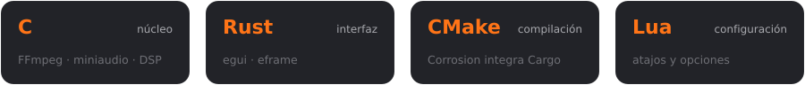

<details>
<summary><b>Arquitectura</b></summary>

```
                ┌──────────────────────────────────────────────┐
  main.c ──────▶│  núcleo (C)              libcapyro_core      │
  (arranca)     │                                              │
                │  hilo de decodificación ─ FFmpeg             │
                │    demux → colas de paquetes → decode        │
                │      audio → tono/atempo/aresample → ring ───┼──▶ EQ/estéreo/noche ──▶ 🔊
                │      video → swscale → cola RGBA (3 frames)  │    (callback = reloj)
                └──────────────────────▲───────────────────────┘
                                       │ FFI: capyro_core.h
                ┌──────────────────────┴───────────────────────┐
                │  GUI (Rust)  libcapyro_gui — egui/eframe     │
                │  cada frame: update() + pedir frame → textura│
                └──────────────────────▲───────────────────────┘
                                       │ mlua (Lua 5.4 embebido)
                               ~/.config/capyro/capyro.lua
```

- **C es el dueño**: `main.c` crea el núcleo, le pasa el puntero a la GUI y lo libera al cerrar.
- **Tres hilos**: la GUI, el de decodificación y el callback de audio. Un único mutex protege
  lo compartido, y nunca se llama a FFmpeg ni a miniaudio con ese candado tomado.
- **El audio marca el tiempo**: la posición sale de las muestras que realmente sonaron, y el
  video muestra el fotograma que corresponde.
- **Velocidad y tono** van en el grafo de FFmpeg (`atempo`, `asetrate`). El **ecualizador,
  el estéreo y el modo noche** están en C (`core/src/dsp.c`) dentro del callback de audio,
  por eso responden al instante.
- **La lista vive en el núcleo**: orden, aleatorio y repetir se deciden en C. La GUI solo
  muestra y manda comandos.
- **Frontera C ↔ Rust segura**: `CapyroCore` es opaco, los enums viajan como `int`, todo el
  `unsafe` de la interfaz está en `gui/src/ffi.rs` y ningún `panic` cruza hacia C.
- **El binario sabe de dónde salió**: en cada compilación `cmake/buildinfo.cmake` guarda el
  commit, el repo y el prefijo de instalación (`capyro --version` los muestra). El
  actualizador (`gui/src/updater.rs`) corre en su propio hilo y compara ese commit con el del repo.
</details>

<details>
<summary><b>Estructura del proyecto</b></summary>

```
capyro/
├── CMakeLists.txt            # build principal (trae Corrosion)
├── cmake/buildinfo.cmake     # guarda el commit de git en cada build
├── core/                     # ── núcleo en C ──
│   ├── include/capyro_core.h #    API pública (lo único que ve Rust)
│   └── src/
│       ├── core.c            #    API, transporte, lista de reproducción
│       ├── player.c          #    FFmpeg + miniaudio: hilos, colas, reloj
│       ├── dsp.c/.h          #    efectos de audio (EQ, estéreo, modo noche)
│       ├── sfx.c             #    sonidos de la app (decodifica desde memoria)
│       ├── buildinfo.c       #    commit y prefijo del build (para actualizar)
│       ├── platform.c/.h     #    hilos y mutex (pthreads)
│       ├── internal.h        #    estructuras internas
│       ├── miniaudio_impl.c  #    implementación de miniaudio
│       └── main.c            #    punto de entrada
├── gui/                      # ── interfaz en Rust ──
│   └── src/
│       ├── lib.rs            #    capyro_gui_run() + ventana
│       ├── app.rs            #    layout y lógica de la UI
│       ├── app/fx_menu.rs    #    menú de efectos de audio
│       ├── app/lists.rs      #    panel Lista: cola y playlists
│       ├── app/keys_editor.rs #   editor de atajos
│       ├── app/changes_menu.rs #  menú de novedades
│       ├── playlists.rs      #    guardar / leer las playlists
│       ├── changes.rs        #    novedades (lee el CHANGELOG embebido)
│       ├── ffi.rs            #    bindings seguros al núcleo
│       ├── viz.rs            #    visualizador (FFT propia)
│       ├── session.rs        #    guardar / retomar la sesión
│       ├── updater.rs        #    buscar, compilar e instalar actualizaciones
│       ├── config.rs         #    lectura de capyro.lua (mlua)
│       ├── formats.rs        #    resúmenes de cada formato
│       ├── icons.rs          #    íconos dibujados a mano
│       └── theme.rs          #    colores y fuentes
├── config/capyro.lua         # configuración por defecto
├── assets/                   # logo + sounds/ (capibaras, error, inicio, actualización)
├── packaging/                # lanzador .desktop + íconos en todos los tamaños
├── tests/                    # pruebas del núcleo
└── docs/                     # capturas e ilustraciones de este README
```
</details>

<details>
<summary><b>Pruebas</b></summary>

```sh
ctest --test-dir build --output-on-failure   # núcleo en C
cd gui && cargo test                         # config, sesión, visualizador y actualizador
```

`ctest` genera archivos en **todos los formatos** con `ffmpeg` y prueba el núcleo de punta
a punta: reproducción, pausa, búsqueda, fin del archivo, carátulas, fotogramas de video,
lista, aleatorio, repetir y velocidad.

Los efectos se prueban **midiendo el sonido**:
- Graves +12 suben ~12 dB más los 50 Hz que los 5 kHz.
- Mono deja los dos canales iguales.
- Con todo al máximo, nada satura.
- El modo noche achica la diferencia entre lo fuerte y lo bajito.
- Tono +12 convierte un La de 440 Hz en 880 Hz sin cambiar la velocidad.

Sin placa de sonido (un servidor, CI) se usa un dispositivo "nulo" que igual consume el
audio en tiempo real. El núcleo también pasa por ThreadSanitizer y AddressSanitizer.
</details>


## Roadmap y licencia

**Lo que viene**
- [ ] Subtítulos `.srt`
- [ ] Ecualizador gráfico de más bandas y presets propios
- [ ] Más opciones en el menú de ajustes
- [ ] Hooks en Lua (`on_open`, `on_end`, acciones personalizadas)
- [ ] Decodificación por GPU (VA-API) para 4K
- [ ] Otras plataformas, más adelante

**Lo que ya está:** [el historial completo de versiones](CHANGELOG.md).

<br>

Capyro es **software libre** bajo la [GNU GPL v3.0](LICENSE) (o, a tu elección, cualquier
versión posterior): podés usarlo, estudiarlo, compartirlo y modificarlo.

Gracias a [FFmpeg](https://ffmpeg.org/) (LGPL/GPL), [miniaudio](https://miniaud.io/)
(dominio público / MIT-0), [egui](https://github.com/emilk/egui) (MIT/Apache-2.0),
[mlua](https://github.com/mlua-rs/mlua) con Lua 5.4 (MIT) y
[Corrosion](https://github.com/corrosion-rs/corrosion) (MIT).

<div align="center">
<br>

<br>
<b>Capyro</b> · <i>Just press play.</i>
</div>
